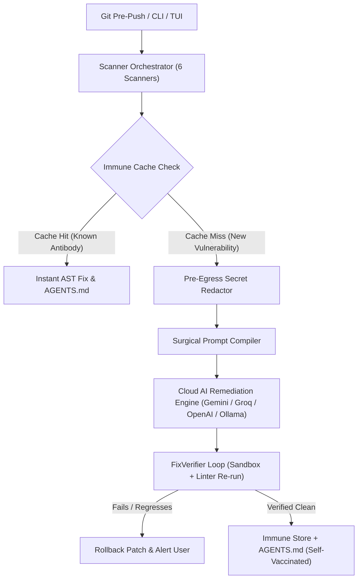

# 🛡️ Vulnora AI (`vulnora`)

[](https://www.python.org/)
[](https://opensource.org/licenses/MIT)
[](https://textual.textualize.io/)
[](#zero-secret-pre-egress-scrubbing)

> **Autonomous Codebase Immunity Sentinel** — Standalone, language-agnostic security CLI & Interactive TUI that turns any Git repository into a **Self-Vaccinating Codebase**.

---

## 🌟 Why Vulnora AI?

Traditional security linters only report errors — they don't fix them safely, and they don't prevent AI coding agents (Cursor, Copilot, Antigravity) from re-introducing the same vulnerabilities in the next prompt.

**Vulnora AI** closes the loop:
1. **Fleet Scanning:** Runs 6 concurrent security scanners (Gitleaks, Semgrep, Bandit, OSV-Scanner, Trivy, OWASP ZAP) with automatic tool gating.
2. **Pre-Egress Zero-Secret Redaction:** Scrubs all API keys, bearer tokens, DB credentials, and high-entropy secrets before anything leaves your machine.
3. **Surgical AI Remediation:** Generates precise, minimal AST-bounded replacements using high-speed LLMs (Google Gemini 2.5 Flash, Groq, OpenAI, or local Ollama).
4. **Dual-Gate Verification:** Applies patches to an isolated sandbox, re-runs linters, and verifies AST preservation. Automatically rolls back if regressions occur.
5. **Lifelong Immunity (`AGENTS.md`):** Records verified antibodies in `.vulnora/memory.json` and writes human/agent guardrails into `AGENTS.md` so coding agents stay immunized forever.
6. **Pre-Push Git Guard:** Seamlessly hooks into `git push` to protect `main` and release branches from critical regressions.

---

## 🚀 Architecture



---

## 📦 Installation

### Option 1: One-Command Global Install via `pipx` (Recommended)
```bash
pipx install git+https://github.com/Aditya-S-0/Vulnora.AI.git
```

### Option 2: Fast Install via `uv`
```bash
uv tool install git+https://github.com/Aditya-S-0/Vulnora.AI.git
```

### Option 3: From Source (Development)
```bash
git clone https://github.com/Aditya-S-0/Vulnora.AI.git
cd Vulnora.AI
python -m venv venv
source venv/bin/activate
pip install -e ".[dev]"
```

Verify installation:
```bash
vulnora --version
```

---

## ⚡ Quickstart

### 1. Initialize Vulnora in Any Repository
```bash
cd /path/to/your/project
vulnora init
```
This generates `.vulnora/config.yaml`, creates local immune storage, and configures `.gitignore`.

### 2. Launch the Interactive Textual TUI
```bash
vulnora tui
```
Opens the keyboard-driven security command center with real-time telemetry, sentinel mascot, findings inspector, and one-key auto-fix.

### 3. Install Pre-Push Protection
```bash
vulnora guard --install-hook
```
Installs an autonomous `.git/hooks/pre-push` script. Any `git push` to protected branches (`main`, `master`, `production`) will be scanned before leaving your machine.

---

## 🖥️ Interactive TUI Dashboard (`vulnora tui`)

The interactive terminal dashboard provides split-pane security inspection and keyboard-driven remediation:

```
┌─ Sentinel Mascot ─────────────┐┌─ Immunity Telemetry ─────────────┐
│    🛡️  [VULNORA SENTINEL]     ││ Immune Memory : 12 Antibodies    │
│       /───\  Posture: VIGILANT ││ Cache Hit Rate: 95.5% Intercept │
│      │ o.o │ Git Push: READY  ││ Target Branch : main (Protected) │
│       \───/                   ││ Cloud AI      : Ready (Key Loaded│
└───────────────────────────────┘└──────────────────────────────────┘
┌─ Detected Findings (45%) ──────┐┌─ Inspection Tabs (55%) ───────────┐
│ [HIGH    ] B605  service.py:10 ││ [Snippet] [Prompt] [Diff] [Rule]  │
│ [MEDIUM  ] CWE89 db.py:25      ││                                   │
└────────────────────────────────┘└───────────────────────────────────┘
 [C]opy  [A]uto-Fix  [K]ey  [R]e-scan  [D]etails  [G]uard  [Q]uit
```

### Keyboard Shortcuts Reference

| Key | Action | Description |
|---|---|---|
| **`[K]`** | **API Key** | In-TUI modal to enter/update Gemini API key (Session or Local `.vulnora/credentials.local`). |
| **`[A]`** | **Auto-Fix** | Synthesizes surgical AI patch and executes full AST Verification Loop. Auto-prompts for key if missing. |
| **`[C]`** | **Copy** | Zero-Secret scrubbed copy of active tab (Snippet, Surgical Prompt, Diff, or Rule) to clipboard. |
| **`[R]`** | **Re-Scan** | Non-blocking background re-scan with all 6 concurrent scanners. |
| **`[D]`** | **Next Tab** | Cycles through details tabs: `Snippet` ➔ `Prompt` ➔ `Diff` ➔ `Guardrail`. |
| **`[G]`** | **Guard** | Approves pre-push inspection or proceeds if codebase is verified clean. |
| **`[Q]`** | **Quit** | Exits TUI. In pre-push guard mode, returns exit code `1` if unresolved threats remain. |

---

## 🔑 In-TUI Gemini API Key Management

Vulnora AI features seamless in-TUI API key management:
- Press **`[K]`** at any time to open the **API Key Configuration Modal**.
- All inputs are **password-masked** so screen recordings and shoulder-surfers see nothing.
- **Save for Session:** Keeps the key in memory only for the current terminal run.
- **Save Locally (`.vulnora`):** Persists the key to `.vulnora/credentials.local` with strict POSIX permissions (`chmod 0o600`, owner read/write only) and automatically ensures it is ignored in `.gitignore`.
- **Automatic Auto-Fix Prompt:** Pressing `[A]` when no key is configured prompts the key entry modal before starting remediation.

Alternatively, set an environment variable before launching:
```bash
export GEMINI_API_KEY="AIzaSy..."
```

---

## 🔒 Zero-Secret Pre-Egress Scrubbing

Vulnora AI guarantees **Zero-Secret Egress**:
- Outbound AI prompts, clipboard copies (`[C]`), and saved immune records are scrubbed prior to transmission.
- Pre-configured detection for PEM private keys, AWS access/secret keys, GitHub PATs, Slack/Stripe tokens, JWTs, database URLs, and high-entropy credential assignments.
- Active Gemini API keys entered via the TUI are automatically registered into the runtime redactor so they can never leak.

---

## 🛠️ CLI Command Reference

| Command | Usage | Description |
|---|---|---|
| `vulnora init` | `vulnora init [--language LANG] [--force]` | Initializes `.vulnora/config.yaml` and local immune storage. |
| `vulnora status` | `vulnora status` | Displays configuration, immune memory count, and scanner tool availability. |
| `vulnora scan` | `vulnora scan [--target DIR] [--scanner NAME]` | Executes concurrent scanner fleet across codebase or staged diff. |
| `vulnora fix` | `vulnora fix --file FILE --line NUM [--model M]` | Surgically fixes a specific finding with AI and verification loop. |
| `vulnora guard` | `vulnora guard [--install-hook] [--uninstall-hook]` | Manages Git pre-push hook or executes pre-push threat inspection. |
| `vulnora pack` | `vulnora pack export / import --file PACK.json` | Exports or imports sharable antibody immunization packs. |
| `vulnora tui` | `vulnora tui [--target DIR]` | Launches the interactive split-pane terminal dashboard. |

---

## 🛡️ Scanner Fleet & Tool Auto-Gating

Vulnora AI orchestrates 6 security tools in parallel:
1. **Gitleaks:** Secret detection and leaked credentials.
2. **Semgrep:** AST semantic rule scanning.
3. **Bandit:** Python AST security analysis.
4. **OSV-Scanner:** Open-source dependency vulnerabilities.
5. **Trivy:** Container and package vulnerability scanning.
6. **OWASP ZAP:** Web endpoint and baseline application security.

**Graceful Degradation:** If any scanner is not installed on your system PATH, Vulnora gates it automatically without crashing or failing your build.

---

## 🧪 Testing

Run test suite with pytest:
```bash
pytest
```
Run TUI and Phase 6 tests:
```bash
pytest tests/test_tui_api_key.py tests/test_tui_app.py tests/test_cli_phase6.py
```

---

## 📄 License

Vulnora AI is licensed under the [MIT License](LICENSE).
