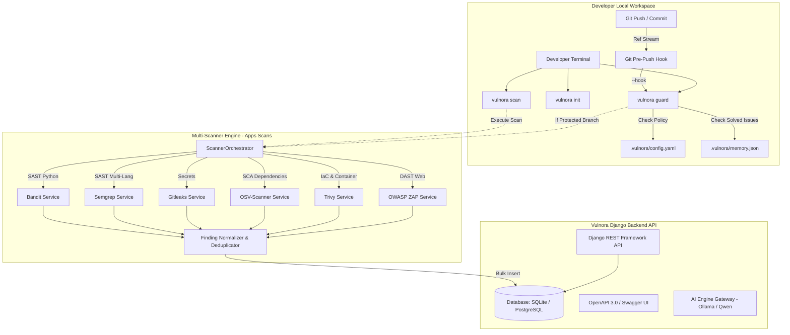

# Vulnora AI — Comprehensive Project Summary & Architecture Guide

---

## 1. Project Executive Overview

**Vulnora AI** is an advanced, branch-aware autonomous security orchestration platform and command-line security guard (`vulnora`). It is engineered to safeguard software repositories against security regressions, hardcoded secret leaks, vulnerable dependencies, and infrastructure misconfigurations prior to code integration.

Vulnora intercepts developer Git pushes targeting designated protected branches (such as `main`, `production`, or `staging`), validates changes through a multi-engine security scanning pipeline, consults local and cloud-synced issue memory, and interfaces with remote open-weight AI inference models (such as Qwen 2.5 Coder or Devstral via Ollama) to automatically reason about vulnerabilities and synthesize remediation patches.

### Core Capabilities
1. **Branch-Aware Push Interception (`vulnora guard` & Git Pre-Push Hook):**
   - Automatically intercepts `git push` commands.
   - Analyzes target ref updates streamed from Git standard input.
   - Evaluates push destination branches against configurable branch protection policies (`.vulnora/config.yaml`).
   - Bypasses non-protected feature branches and tag/branch deletions to avoid hindering developer velocity.
   - Safely chains existing developer pre-push hooks without destructive overwrites.
2. **Multi-Scanner Security Orchestration (`apps.scans`):**
   - Orchestrates 6 specialized open-source security scanners concurrently across source code, dependencies, container configs, and live web targets:
     - **Gitleaks:** High-speed secrets and API key leak detection with mandatory masking.
     - **Semgrep:** Multi-language Static Application Security Testing (SAST) rule evaluation.
     - **Bandit:** Deep Python AST security analysis (detecting eval, command injection, insecure hashes, SQLi).
     - **OSV-Scanner:** Open-source dependency auditing against Google’s OSV vulnerability database.
     - **Aqua Security Trivy:** Comprehensive container, dependency, and Infrastructure-as-Code (IaC) scanner.
     - **OWASP ZAP (Zed Attack Proxy):** Dynamic Application Security Testing (DAST) for live web applications via daemon REST API, local CLI, or built-in embedded DAST baseline engine.
3. **Unified Findings Normalization & Deduplication:**
   - Normalizes disparate scanner outputs into a standardized data model (`NormalizedFinding` / `Finding`).
   - Calculates deterministic SHA-256 fingerprints for findings to eliminate duplicate reports across scanner overlapping boundaries.
4. **Issue Memory & Remediation Store (`vulnora.cli.memory` & `apps.remediation`):**
   - Tracks accepted risks, discarded false positives, and historical remediations in `.vulnora/memory.json`.
   - Prevents repetitive developer prompting for known, accepted architectural decisions.
5. **AI Remediation Engine Gateway (`apps.ai_engine`):**
   - Scaffolding for local and remote open-weight AI inference (Ollama integration).
   - Designed to redact sensitive context before egress and generate diff-ready patches.
6. **Centralized Django REST Framework API & Interactive Documentation:**
   - Production-ready DRF backend serving API consumers, CLI clients, and CI/CD pipelines.
   - Auto-generated OpenAPI 3.0 schema and interactive Swagger UI / ReDoc interfaces via `drf-spectacular`.

---

## 2. Project File Structure

Below is the directory tree of the Vulnora AI codebase (excluding virtual environment directories and bytecode artifacts):

```text
Vulnora.AI/
├── .env.example                        # Template environment variables for local & production deployments
├── .gitignore                          # Git ignore rules for Python, cache, and Vulnora state
├── manage.py                           # Django management CLI utility with apps path resolution
├── pyproject.toml                      # PEP 517/621 packaging metadata, dependencies, and CLI entry point
├── README.md                           # Project documentation, quickstart, and CLI guides
├── requirements.txt                    # Project Python package dependencies
├── summary.md                          # Comprehensive project summary and function reference
├── test_scanners.py                    # Standalone end-to-end scanner verification utility
│
├── apps/                               # Modular Django Applications Directory
│   ├── __init__.py                     # Package marker for apps root
│   │
│   ├── ai_engine/                      # Remote AI Inference Gateway Module
│   │   ├── __init__.py
│   │   ├── admin.py                    # Django admin model registrations (scaffolded)
│   │   ├── apps.py                     # App configuration (AiEngineConfig)
│   │   ├── models.py                   # Data models for inference sessions & redaction logs (scaffolded)
│   │   ├── serializers.py              # DRF serializers (AiEngineModuleInfoSerializer)
│   │   ├── tests.py                    # Unit tests for AI Engine API views
│   │   ├── urls.py                     # Route declarations for AI Engine module
│   │   └── views.py                    # API views (AiEngineModuleIndexView)
│   │
│   ├── core/                           # System Core, Health Probes & Base Models
│   │   ├── __init__.py
│   │   ├── admin.py                    # Core admin registrations
│   │   ├── apps.py                     # App configuration (CoreConfig)
│   │   ├── models.py                   # Abstract base models (TimeStampedModel with UUID PK)
│   │   ├── serializers.py              # Health check & system status serializers
│   │   ├── tests.py                    # Unit tests for core endpoints & documentation routes
│   │   ├── urls.py                     # URL routing for /, /health/, and /status/
│   │   └── views.py                    # ApiRootView, HealthCheckView, SystemStatusView
│   │
│   ├── projects/                       # Repositories & Branch Protection Policies
│   │   ├── __init__.py
│   │   ├── admin.py                    # Admin model registrations (scaffolded)
│   │   ├── apps.py                     # App configuration (ProjectsConfig)
│   │   ├── models.py                   # Repository and BranchPolicy data models (scaffolded)
│   │   ├── serializers.py              # ProjectModuleInfoSerializer
│   │   ├── tests.py                    # Unit tests for project endpoints
│   │   ├── urls.py                     # Route declarations for projects module
│   │   └── views.py                    # API views (ProjectModuleIndexView)
│   │
│   ├── remediation/                    # Remediation Workflows & Issue Memory
│   │   ├── __init__.py
│   │   ├── admin.py                    # Admin model registrations (scaffolded)
│   │   ├── apps.py                     # App configuration (RemediationConfig)
│   │   ├── models.py                   # Models for IssueMemoryEntry & RemediationPatch (scaffolded)
│   │   ├── serializers.py              # RemediationModuleInfoSerializer
│   │   ├── tests.py                    # Unit tests for remediation endpoints
│   │   ├── urls.py                     # Route declarations for remediation module
│   │   └── views.py                    # API views (RemediationModuleIndexView)
│   │
│   └── scans/                          # Multi-Scanner Orchestration & Findings Store
│       ├── __init__.py
│       ├── admin.py                    # Django admin classes for ScanSession and Finding
│       ├── apps.py                     # App configuration (ScansConfig)
│       ├── migrations/                 # Database schema migrations
│       │   ├── 0001_initial.py         # Initial models (ScanSession, Finding)
│       │   ├── 0002_scansession_target_url_and_more.py # Added target_url and extended DAST support
│       │   └── __init__.py
│       ├── models.py                   # ScanStatus, Severity, ScanSession, Finding models
│       ├── serializers.py              # DRF serializers for scan sessions, findings, and summaries
│       ├── tests.py                    # Test suites for all 6 scanners, mock DAST server, and APIs
│       ├── urls.py                     # URL routing for scans, findings, and summaries
│       ├── views.py                    # ScanListCreateView, ScanDetailView, ScanSummaryView, VulnerabilityListView
│       └── services/                   # Modular Security Scanner Services Engine
│           ├── __init__.py
│           ├── bandit.py               # Bandit Python AST static scanner service
│           ├── base.py                 # BaseScannerService abstract class & subprocess runner
│           ├── data_structures.py      # NormalizedFinding & ScannerExecutionResult dataclasses
│           ├── gitleaks.py             # Gitleaks secret leak detection service
│           ├── orchestrator.py         # ScannerOrchestrator multi-thread coordination engine
│           ├── osv_scanner.py          # OSV-Scanner open source dependency vulnerability auditor
│           ├── semgrep.py              # Semgrep multi-language SAST pattern scanner service
│           ├── trivy.py                # Aqua Security Trivy container, dep, and IaC scanner
│           └── zap.py                  # OWASP ZAP DAST web application security scanner
│
└── vulnora/                            # Project Root Configuration & CLI Package
    ├── __init__.py
    ├── asgi.py                         # ASGI entry point for async server deployments
    ├── urls.py                         # Root URL dispatcher and Swagger / OpenAPI routes
    ├── wsgi.py                         # WSGI entry point for web server deployments
    │
    ├── cli/                            # Vulnora Command-Line Interface (`vulnora`)
    │   ├── __init__.py
    │   ├── ai_client.py                # Remote AI inference (Ollama), secret redaction, and code extraction
    │   ├── config.py                   # Configuration reader/writer (.vulnora/config.yaml)
    │   ├── git_utils.py                # Git detection, branch parsing, and .gitignore maintenance
    │   ├── hook_manager.py             # Pre-push hook installer, chained hook preservation
    │   ├── main.py                     # Typer CLI application entry point and command registration
    │   ├── memory.py                   # Issue memory manager (.vulnora/memory.json)
    │   ├── remediation_workflow.py     # Accept/Discard remediation loop, memory sync, and rescan verification
    │   ├── ui.py                       # Rich console UI, ASCII Sentinel mascot, and split-pane layout
    │   ├── commands/                   # Subcommands implementation
    │   │   ├── __init__.py
    │   │   ├── guard_cmd.py            # `vulnora guard` command (branch evaluation & hook handling)
    │   │   ├── init_cmd.py             # `vulnora init` command (workspace initialization)
    │   │   └── scan_cmd.py             # `vulnora scan` command (scanner triggering & status)
    │   └── tests/                      # CLI unit and integration test suites
    │       ├── __init__.py
    │       ├── test_ai_and_memory.py   # Unit & integration tests for AI client, secrets, memory, and workflow
    │       ├── test_cli.py             # Unit tests for CLI commands and options
    │       └── test_git_hook.py        # 10 comprehensive tests for Git hook lifecycle and push interception
    │
    └── settings/                       # Environment-Specific Django Settings
        ├── __init__.py
        ├── base.py                     # Shared base configuration, middleware, DB, DRF settings
        ├── development.py              # Local development configuration (DEBUG=True, permissive CORS)
        └── production.py               # Hardened production settings (SSL, HSTS, security headers)
```

---

## 3. Detailed Architecture & Technical Summary

Vulnora AI is architected around two primary interacting runtimes: the **Developer Workspace CLI (`vulnora`)** and the **Central Backend Platform (`apps`)**.

### 3.1 Architecture Overview



---

### 3.2 Component Details

#### 1. CLI & Git Hook Interception Engine (`vulnora.cli`)
- **Initialization (`vulnora init`):**
  - Verifies Git repository status (`is_git_repository`).
  - Generates the `.vulnora/` configuration folder containing `config.yaml` and `memory.json`.
  - Appends cache and sensitive local state entries to `.gitignore` to prevent committing memory files.
  - Installs an executable Git pre-push hook script (`.git/hooks/pre-push`).
- **Hook Lifecycle & Non-Destructive Chaining (`hook_manager.py`):**
  - If a pre-existing developer hook exists, Vulnora backs it up to `.git/hooks/pre-push.pre-vulnora`.
  - The installed hook script forwards standard input (`<local_ref> <local_sha> <remote_ref> <remote_sha>`) first to the chained original hook, and then to `vulnora guard --hook`.
  - Employs the recursion guard environment variable `VULNORA_GUARD_RUNNING` to prevent infinite loops.
- **Branch Gatekeeping (`vulnora guard`):**
  - Parses Git ref streams using `parse_push_refs`.
  - Detects if any target ref matches protected branch patterns (`main`, `production`, etc.).
  - Safely ignores tag pushes (`refs/tags/*`) and branch deletions (zero SHA).
  - If target is protected, halts execution, displays the Rich Sentinel mascot in alert state, and triggers policy enforcement.
  - If target is an unprotected feature branch, grants pass-through immediately.
- **Rich Terminal UI & Sentinel Mascot (`ui.py`):**
  - Features dynamic ASCII mascot states: `ready` (green), `scanning` (yellow), `guarding` (cyan), and `alert` (red).
  - Renders a two-column responsive split pane with the Sentinel mascot on the left and streaming logs on the right.

#### 2. Multi-Scanner Security Engine (`apps.scans.services`)
- **Subprocess Safety (`BaseScannerService`):**
  - Strictly avoids `shell=True` to prevent shell injection vulnerabilities.
  - Resolves binaries across virtual environment `Scripts/bin`, Windows WinGet links, and system `PATH`.
  - Implements configurable timeouts per scanner to prevent hung builds or deadlocks.
- **Integrated Tool Suite:**
  - **Bandit:** Recursively inspects Python code using the official JSON output format. Flags high-risk AST calls (`eval`, `exec`, `subprocess(shell=True)`, SQL concatenation).
  - **Gitleaks:** Executes directory-level secret scans with mandatory `--redact` enabled. Guarantees that secrets are replaced with `***REDACTED***` in memory and persistent storage.
  - **Semgrep:** Executes rulesets (`p/default`) in JSON mode without telemetry metrics. Normalizes findings with CWE and OWASP mappings.
  - **OSV-Scanner:** Automatically discovers manifest files (`requirements.txt`, `Pipfile.lock`, `package-lock.json`, etc.) and queries Google's Open Source Vulnerabilities database for known CVEs.
  - **Trivy:** Analyzes filesystem software packages and Dockerfiles/IaC templates for misconfigurations (e.g. running containers as root).
  - **OWASP ZAP:** Evaluates running web applications via:
    1. Active ZAP Daemon REST API (`http://127.0.0.1:8080`).
    2. Headless ZAP CLI (`zap -cmd -quickurl`).
    3. Embedded DAST Baseline Analyzer (validates CSP, X-Frame-Options, X-Content-Type-Options, HSTS, secure cookies, reflected XSS, and SQL injection error patterns).
- **Scanner Orchestrator (`ScannerOrchestrator`):**
  - Manages concurrent scanner execution using Python's `concurrent.futures.ThreadPoolExecutor`.
  - Deduplicates overlapping findings across tools using a deterministic SHA-256 fingerprint:
    `SHA256(scanner_name:rule_id:file_path:line_number)[:32]`.
  - Persists overall status (`COMPLETED`, `PARTIALLY_FAILED`, `FAILED`, `TIMED_OUT`) and individual scanner metrics to the database.

#### 3. Backend REST API & Django Applications (`apps/`)
- **`apps.core`:** Provides system health probes (`/api/v1/health/`), database readiness checks (`/api/v1/status/`), API root discovery (`/api/v1/`), and the abstract `TimeStampedModel`.
- **`apps.projects`:** Scaffolded for multi-repository configuration, branch gatekeeping rules, and permission policies.
- **`apps.scans`:** Full CRUD and execution endpoints for scan sessions and normalized vulnerabilities.
- **`apps.remediation`:** Scaffolded for syncing `.vulnora/memory.json` to the cloud, managing accepted vulnerabilities, and verifying patches.
- **`apps.ai_engine`:** Scaffolding for routing complex vulnerabilities to remote Ollama inference instances for diff synthesis.

---

## 4. Comprehensive Function-by-Function Reference

This section provides granular documentation for **every function, method, and command** across the entire Vulnora AI codebase.

---

### 4.1 Root & Utilities

#### `manage.py`
- `main()`:
  - **Signature:** `def main() -> None`
  - **Description:** Entry point for Django administrative tasks. Adds `apps/` to `sys.path` so that modular Django apps are discovered without prefixes, sets default `DJANGO_SETTINGS_MODULE` to `vulnora.settings.development`, and delegates execution to Django's `execute_from_command_line`.

#### `test_scanners.py`
- `MockDASTServer.do_GET(self)`:
  - **Signature:** `def do_GET(self) -> None`
  - **Description:** Handles HTTP GET requests for the temporary mock HTTP server used to test OWASP ZAP DAST scanning. Returns HTTP 200 with basic HTML omitting standard security headers.
- `MockDASTServer.log_message(self, format, *args)`:
  - **Signature:** `def log_message(self, format, *args) -> None`
  - **Description:** Overridden to suppress default HTTP request logging to stderr during test execution.
- `run_test(custom_path=None, custom_url=None)`:
  - **Signature:** `def run_test(custom_path: Optional[str] = None, custom_url: Optional[str] = None) -> None`
  - **Description:** Standalone test runner that verifies all 6 scanners. Spawns `MockDASTServer` if no URL is provided, generates vulnerable Python, requirements, and Dockerfile fixtures in a temporary sandbox if no path is given, runs all scanners concurrently through `ScannerOrchestrator`, and prints a detailed report.

---

### 4.2 Vulnora CLI (`vulnora/cli/`)

#### `vulnora/cli/main.py`
- `version_callback(value: bool)`:
  - **Signature:** `def version_callback(value: bool) -> None`
  - **Description:** Typer eager callback. If `--version` or `-v` is provided on the command line, prints the formatted Vulnora version using `rich.console` and terminates execution cleanly via `typer.Exit()`.
- `main(version: Optional[bool])`:
  - **Signature:** `def main(version: Optional[bool] = typer.Option(...)) -> None`
  - **Description:** Top-level Typer application callback. Displays command-line help when invoked without subcommands.

#### `vulnora/cli/config.py`
- `_deep_merge_dict(base: Dict[str, Any], override: Dict[str, Any]) -> Dict[str, Any]`:
  - **Signature:** `def _deep_merge_dict(base: Dict[str, Any], override: Dict[str, Any]) -> Dict[str, Any]`
  - **Description:** Recursively merges nested override dictionary into base dictionary, guaranteeing older `.vulnora/config.yaml` files inherit newly added default configuration keys without losing custom settings.
- `get_vulnora_dir(base_path: Optional[Path] = None) -> Path`:
  - **Signature:** `def get_vulnora_dir(base_path: Optional[Path] = None) -> Path`
  - **Description:** Resolves and returns the canonical path to the `.vulnora` directory for the given base path or current working directory.
- `get_config_path(base_path: Optional[Path] = None) -> Path`:
  - **Signature:** `def get_config_path(base_path: Optional[Path] = None) -> Path`
  - **Description:** Returns the path to `.vulnora/config.yaml`.
- `load_config(base_path: Optional[Path] = None) -> Dict[str, Any]`:
  - **Signature:** `def load_config(base_path: Optional[Path] = None) -> Dict[str, Any]`
  - **Description:** Reads and parses `.vulnora/config.yaml` using PyYAML. Deep-merges loaded data over `DEFAULT_CONFIG_TEMPLATE`. If the file does not exist or parsing fails, returns a copy of `DEFAULT_CONFIG_TEMPLATE`.
- `save_config(config_data: Dict[str, Any], base_path: Optional[Path] = None) -> Path`:
  - **Signature:** `def save_config(config_data: Dict[str, Any], base_path: Optional[Path] = None) -> Path`
  - **Description:** Serializes `config_data` to `.vulnora/config.yaml`, creating parent directories if necessary. Returns the path to the written file.
- `get_protected_branches(base_path: Optional[Path] = None) -> List[str]`:
  - **Signature:** `def get_protected_branches(base_path: Optional[Path] = None) -> List[str]`
  - **Description:** Extracts the list of configured protected branches from the repository configuration (`git.protected_branches`), defaulting to `["main", "production"]`.
- `is_pre_push_hook_enabled(base_path: Optional[Path] = None) -> bool`:
  - **Signature:** `def is_pre_push_hook_enabled(base_path: Optional[Path] = None) -> bool`
  - **Description:** Checks whether the Git pre-push hook is enabled in `config.yaml` (`git.pre_push_hook.enabled`). Returns `True` by default.
- `get_ai_config(base_path: Optional[Path] = None) -> Dict[str, Any]`:
  - **Signature:** `def get_ai_config(base_path: Optional[Path] = None) -> Dict[str, Any]`
  - **Description:** Returns the configured AI inference dictionary containing `enabled`, `base_url`, `model`, `timeout_seconds`, and `think`.
- `get_write_permission(base_path: Optional[Path] = None) -> str`:
  - **Signature:** `def get_write_permission(base_path: Optional[Path] = None) -> str`
  - **Description:** Returns the configured write permission mode (`'prompt'` or `'auto'`).
- `ensure_django_setup()`:
  - **Signature:** `def ensure_django_setup() -> None`
  - **Description:** Initializes Django settings and application registry when CLI commands (`guard`, `scan`) execute in standalone environments outside `manage.py`.


#### `vulnora/cli/git_utils.py`
- `is_git_installed() -> bool`:
  - **Signature:** `def is_git_installed() -> bool`
  - **Description:** Runs `git --version` in a subprocess with a 5-second timeout to check if the `git` executable exists in system `PATH`. Returns `True` if returncode is 0.
- `is_git_repository(target_path: Optional[Path] = None) -> bool`:
  - **Signature:** `def is_git_repository(target_path: Optional[Path] = None) -> bool`
  - **Description:** Checks if `target_path` is inside a Git working tree via `git rev-parse --is-inside-work-tree`. Includes fallback directory traversal checking for `.git`.
- `get_git_root(target_path: Optional[Path] = None) -> Optional[Path]`:
  - **Signature:** `def get_git_root(target_path: Optional[Path] = None) -> Optional[Path]`
  - **Description:** Finds the top-level directory of the Git repository using `git rev-parse --show-toplevel`. Falls back to walking parent directories for `.git`.
- `get_current_branch(target_path: Optional[Path] = None) -> Optional[str]`:
  - **Signature:** `def get_current_branch(target_path: Optional[Path] = None) -> Optional[str]`
  - **Description:** Resolves the currently active branch name via `git rev-parse --abbrev-ref HEAD`. Returns `"HEAD (detached)"` if in detached state or `None` if not in a Git repository.
- `get_repo_name(target_path: Optional[Path] = None) -> str`:
  - **Signature:** `def get_repo_name(target_path: Optional[Path] = None) -> str`
  - **Description:** Returns the directory name of the Git repository root or target path.
- `get_git_hooks_dir(target_path: Optional[Path] = None) -> Optional[Path]`:
  - **Signature:** `def get_git_hooks_dir(target_path: Optional[Path] = None) -> Optional[Path]`
  - **Description:** Locates the Git hooks directory. Checks `core.hooksPath` configuration first, then `.git/hooks`, and handles Git worktrees or submodules (where `.git` is a file pointing to a gitdir).
- `parse_push_refs(raw_input: str) -> List[PushRefUpdate]`:
  - **Signature:** `def parse_push_refs(raw_input: str) -> List[PushRefUpdate]`
  - **Description:** Parses Git pre-push hook standard input lines formatted as `<local_ref> <local_sha> <remote_ref> <remote_sha>`. Detects branch deletions (40/64 zero SHAs), tags (`refs/tags/*`), and target branch names. Returns a list of `PushRefUpdate` dataclass instances.
- `is_protected_branch(branch_name: Optional[str], protected_branches: List[str]) -> bool`:
  - **Signature:** `def is_protected_branch(branch_name: Optional[str], protected_branches: List[str]) -> bool`
  - **Description:** Case-insensitive comparison checking if `branch_name` matches any branch in `protected_branches`.
- `update_gitignore(git_root: Path, patterns_to_add: List[str]) -> List[str]`
  - **Signature:** `def update_gitignore(git_root: Path, patterns_to_add: List[str]) -> List[str]`
  - **Description:** Ensures Vulnora local state, cache, and memory paths are ignored in `.gitignore`. Adds a section header if missing and appends non-duplicate patterns. Returns the list of newly added entries.

#### `vulnora/cli/hook_manager.py`
- `get_hook_path(target_path: Optional[Path] = None) -> Optional[Path]`:
  - **Signature:** `def get_hook_path(target_path: Optional[Path] = None) -> Optional[Path]`
  - **Description:** Returns the absolute path to `.git/hooks/pre-push` if the hooks directory is available.
- `is_hook_installed(target_path: Optional[Path] = None) -> bool`:
  - **Signature:** `def is_hook_installed(target_path: Optional[Path] = None) -> bool`
  - **Description:** Checks if `.git/hooks/pre-push` exists and contains the Vulnora marker comment (`# Vulnora AI Git Pre-Push Hook - BEGIN`).
- `make_executable(file_path: Path)`:
  - **Signature:** `def make_executable(file_path: Path) -> None`
  - **Description:** Grants execute permissions (`chmod +x`) on the target file across POSIX systems and Windows Git environments.
- `install_pre_push_hook(target_path: Optional[Path] = None, force: bool = False) -> Tuple[bool, str]`:
  - **Signature:** `def install_pre_push_hook(target_path: Optional[Path] = None, force: bool = False) -> Tuple[bool, str]`
  - **Description:** Installs the pre-push hook script. If an existing non-Vulnora hook exists, copies it to `pre-push.pre-vulnora` to chain execution safely. Enforces LF line endings for POSIX/Git Bash compatibility. Returns `(success, status_message)`.
- `uninstall_pre_push_hook(target_path: Optional[Path] = None) -> Tuple[bool, str]`:
  - **Signature:** `def uninstall_pre_push_hook(target_path: Optional[Path] = None) -> Tuple[bool, str]`
  - **Description:** Removes the Vulnora pre-push hook. If a backed-up chained hook (`pre-push.pre-vulnora`) exists, restores it as the active pre-push hook.

#### `vulnora/cli/ai_client.py`
- `redact_secrets(text: str) -> str`:
  - **Signature:** `def redact_secrets(text: str) -> str`
  - **Description:** Idempotently detects and replaces sensitive credentials, API keys (GitHub, Stripe, AWS, Google, Slack), private keys (PEM format), bearer tokens, and password/secret assignments with `***REDACTED***`.
- `extract_code_context(file_path: Path, line_number: Optional[int], context_lines: int = 12) -> str`:
  - **Signature:** `def extract_code_context(file_path: Path, line_number: Optional[int], context_lines: int = 12) -> str`
  - **Description:** Safely extracts surrounding source code lines around a finding's line number and returns the snippet with `redact_secrets` applied.
- `request_remediation(finding: Dict[str, Any], project_root: Path, ai_config: Dict[str, Any]) -> Dict[str, Any]`:
  - **Signature:** `def request_remediation(finding: Dict[str, Any], project_root: Path, ai_config: Dict[str, Any]) -> Dict[str, Any]`
  - **Description:** Queries the remote Ollama inference server (`/api/generate`) with a structured security prompt requesting strict JSON. Gracefully parses responses (stripping markdown fences and `<think>` tags) into a normalized dictionary (`root_cause`, `explanation`, `replacement_code`, `model`, `raw_response`).
- `apply_patch_to_file(file_path: Path, line_number: Optional[int], replacement_code: str, end_line_number: Optional[int] = None) -> bool`:
  - **Signature:** `def apply_patch_to_file(file_path: Path, line_number: Optional[int], replacement_code: str, end_line_number: Optional[int] = None) -> bool`
  - **Description:** Applies proposed code changes to the target source file, replacing specified line ranges while preserving indentation.
- `verify_scanner_fix(project_root: Path, file_path: Path, scanner_name: str, rule_id: str) -> bool`:
  - **Signature:** `def verify_scanner_fix(project_root: Path, file_path: Path, scanner_name: str, rule_id: str) -> bool`
  - **Description:** Re-runs the scanner targeting the modified file to verify whether the vulnerability rule is no longer detected.

#### `vulnora/cli/memory.py`
- `get_memory_path(base_path: Optional[Path] = None) -> Path`:
  - **Signature:** `def get_memory_path(base_path: Optional[Path] = None) -> Path`
  - **Description:** Returns the absolute path to `.vulnora/memory.json`.
- `init_memory(base_path: Optional[Path] = None, overwrite: bool = False) -> Path`:
  - **Signature:** `def init_memory(base_path: Optional[Path] = None, overwrite: bool = False) -> Path`
  - **Description:** Initializes `.vulnora/memory.json` with standard schema fields (`accepted_vulnerabilities`, `discarded_vulnerabilities`, `issue_memory`, `scan_history`) and ISO-8601 timestamps. Does not overwrite unless `overwrite=True`.
- `load_memory(base_path: Optional[Path] = None) -> Dict[str, Any]`:
  - **Signature:** `def load_memory(base_path: Optional[Path] = None) -> Dict[str, Any]`
  - **Description:** Reads and deserializes JSON from `.vulnora/memory.json`. Returns `DEFAULT_MEMORY_TEMPLATE` if missing or corrupted.
- `save_memory(data: Dict[str, Any], base_path: Optional[Path] = None) -> Path`:
  - **Signature:** `def save_memory(data: Dict[str, Any], base_path: Optional[Path] = None) -> Path`
  - **Description:** Updates `last_updated` timestamp and serializes `data` to `.vulnora/memory.json`.
- `compute_pattern_key(finding: Dict[str, Any]) -> str`:
  - **Signature:** `def compute_pattern_key(finding: Dict[str, Any]) -> str`
  - **Description:** Computes a deterministic 32-character SHA-256 pattern signature from `scanner_name`, `rule_id`, and `fingerprint`/`file_path`.
- `lookup_memory_fix(memory_data: Dict[str, Any], finding: Dict[str, Any]) -> Optional[Dict[str, Any]]`:
  - **Signature:** `def lookup_memory_fix(memory_data: Dict[str, Any], finding: Dict[str, Any]) -> Optional[Dict[str, Any]]`
  - **Description:** Searches `issue_memory` for previously verified fixes matching pattern key or `(scanner_name, rule_id)` to resolve known issues immediately without invoking remote AI.
- `is_vulnerability_discarded(memory_data: Dict[str, Any], finding: Dict[str, Any]) -> bool`:
  - **Signature:** `def is_vulnerability_discarded(memory_data: Dict[str, Any], finding: Dict[str, Any]) -> bool`
  - **Description:** Evaluates `discarded_vulnerabilities` to determine if a finding was previously reviewed and marked as discarded.
- `record_verified_fix(memory_data: Dict[str, Any], finding: Dict[str, Any], fix_payload: Dict[str, Any], file_path: str) -> Dict[str, Any]`:
  - **Signature:** `def record_verified_fix(memory_data: Dict[str, Any], finding: Dict[str, Any], fix_payload: Dict[str, Any], file_path: str) -> Dict[str, Any]`
  - **Description:** Stores verified patch metadata (with `redact_secrets` applied to replacement code) in `issue_memory` and appends to `accepted_vulnerabilities`.
- `record_discarded_finding(memory_data: Dict[str, Any], finding: Dict[str, Any], reason: str = "discarded_by_user") -> Dict[str, Any]`:
  - **Signature:** `def record_discarded_finding(memory_data: Dict[str, Any], finding: Dict[str, Any], reason: str = "discarded_by_user") -> Dict[str, Any]`
  - **Description:** Records a developer decision to discard a vulnerability into `discarded_vulnerabilities`.

#### `vulnora/cli/remediation_workflow.py`
- `run_remediation_workflow(project_root: Path, findings: List[Any], interactive: bool = True, auto_accept: Optional[bool] = None) -> Tuple[List[Any], List[Any], List[Any]]`:
  - **Signature:** `def run_remediation_workflow(project_root: Path, findings: List[Any], interactive: bool = True, auto_accept: Optional[bool] = None) -> Tuple[List[Any], List[Any], List[Any]]`
  - **Description:** Central coordinator executing the Accept/Discard remediation loop. Filters out previously discarded issues, consults issue memory, falls back to remote AI, presents Rich UI diff cards, prompts developers according to `write_permission`, applies fixes, executes verification rescans, and updates `.vulnora/memory.json`.

#### `vulnora/cli/ui.py`
- `get_mascot_panel(state: str = "ready", subtitle: Optional[str] = None) -> Panel`:
  - **Signature:** `def get_mascot_panel(state: str = "ready", subtitle: Optional[str] = None) -> Panel`
  - **Description:** Returns a Rich `Panel` containing ASCII mascot art corresponding to `ready`, `scanning`, `guarding`, or `alert` state with appropriate colors.
- `render_split_pane(mascot_state: str, log_title: str, log_lines: List[str], mascot_subtitle: Optional[str] = None, border_style: str = "blue") -> Layout`:
  - **Signature:** `def render_split_pane(mascot_state: str, log_title: str, log_lines: List[str], mascot_subtitle: Optional[str] = None, border_style: str = "blue") -> Layout`
  - **Description:** Generates a Rich split-pane layout consisting of a left mascot column and a right execution log panel.
- `display_remediation_card(finding: dict, fix_payload: dict, source: str = "Remote AI")`:
  - **Signature:** `def display_remediation_card(finding: dict, fix_payload: dict, source: str = "Remote AI") -> None`
  - **Description:** Renders a styled Rich panel displaying finding details, root cause, remediation explanation, and proposed replacement code.
- `print_banner()`:
  - **Signature:** `def print_banner() -> None`
  - **Description:** Prints the official stylized Vulnora AI cyan terminal banner.
- `print_success(message: str)`:
  - **Signature:** `def print_success(message: str) -> None`
  - **Description:** Prints a green checkmark success message.
- `print_warning(message: str)`:
  - **Signature:** `def print_warning(message: str) -> None`
  - **Description:** Prints a yellow warning message.
- `print_error(message: str, detail: Optional[str] = None)`:
  - **Signature:** `def print_error(message: str, detail: Optional[str] = None) -> None`
  - **Description:** Prints a formatted red error message with optional detail text.
- `print_info(message: str)`:
  - **Signature:** `def print_info(message: str) -> None`
  - **Description:** Prints a formatted informational message.

#### `vulnora/cli/commands/init_cmd.py`
- `init_command(project_path: Optional[str], force: bool)`:
  - **Signature:** `def init_command(project_path: Optional[str] = typer.Option(None, "--path", "-p"), force: bool = typer.Option(False, "--force", "-f")) -> None`
  - **Description:** Implements `vulnora init`. Validates Git repository status, creates `.vulnora/`, generates `config.yaml` and `memory.json`, adds ignore rules to `.gitignore`, installs the Git pre-push hook, and displays completion status in the split-pane UI.

#### `vulnora/cli/commands/guard_cmd.py`
- `guard_command(remote_name, remote_url, hook_mode, project_path, branch_override)`:
  - **Signature:** `def guard_command(remote_name: Optional[str] = typer.Argument(None), remote_url: Optional[str] = typer.Argument(None), hook_mode: bool = typer.Option(False, "--hook"), project_path: Optional[str] = typer.Option(None, "--path", "-p"), branch_override: Optional[str] = typer.Option(None, "--branch", "-b")) -> None`
  - **Description:** Implements `vulnora guard`. Dispatches execution to `_handle_hook_execution` if invoked via Git pre-push hook (or receiving non-empty stdin), or `_handle_manual_execution` if executed manually in a terminal.
- `_handle_hook_execution(stdin_content: str, repo_root: Path, repo_name: str, remote_name: Optional[str], remote_url: Optional[str])`:
  - **Signature:** `def _handle_hook_execution(stdin_content: str, repo_root: Path, repo_name: str, remote_name: Optional[str], remote_url: Optional[str]) -> None`
  - **Description:** Processes ref updates streamed from Git standard input. Bypasses security checks for branch deletions and tags. If any push destination matches a protected branch, triggers the Sentinel Alert and halts push if vulnerabilities violate zero-tolerance policies.
- `_handle_manual_execution(target: Path, repo_name: str, branch_override: Optional[str])`:
  - **Signature:** `def _handle_manual_execution(target: Path, repo_name: str, branch_override: Optional[str]) -> None`
  - **Description:** Handles manual CLI evaluation of `vulnora guard`. Inspects the active branch (or `--branch` override) against protected branch rules and displays current enforcement policies in the Sentinel split pane.

#### `vulnora/cli/commands/scan_cmd.py`
- `scan_command(project_path: Optional[str], target_url: Optional[str], scanners: Optional[List[str]])`:
  - **Signature:** `def scan_command(project_path: Optional[str] = typer.Option(None, "--path", "-p"), target_url: Optional[str] = typer.Option(None, "--target-url", "-u"), scanners: Optional[List[str]] = typer.Option(None, "--scanner", "-s")) -> None`
  - **Description:** Implements `vulnora scan`. Prepares scanner execution settings, verifies targets, displays queued scanner stages (SAST, secrets, DAST), and outputs the Sentinel scanning mascot layout.

---

### 4.3 Multi-Scanner Services (`apps/scans/services/`)

#### `apps/scans/services/data_structures.py`
- `NormalizedFinding.__post_init__(self)`:
  - **Signature:** `def __post_init__(self) -> None`
  - **Description:** Post-initialization hook on `NormalizedFinding` dataclass. If `fingerprint` is not explicitly provided, computes a 32-character SHA-256 hash using `scanner_name`, `rule_id`, `file_path`, and `line_number`.
- `NormalizedFinding.to_dict(self) -> Dict[str, Any]`:
  - **Signature:** `def to_dict(self) -> Dict[str, Any]`
  - **Description:** Serializes `NormalizedFinding` into a dictionary for API payloads or JSON export.
- `ScannerExecutionResult.to_dict(self) -> Dict[str, Any]`:
  - **Signature:** `def to_dict(self) -> Dict[str, Any]`
  - **Description:** Returns summary dictionary containing scanner status, execution duration, finding counts, and any captured error messages.

#### `apps/scans/services/base.py` (`BaseScannerService`)
- `__init__(self, custom_executable_path: Optional[str] = None)`:
  - **Signature:** `def __init__(self, custom_executable_path: Optional[str] = None) -> None`
  - **Description:** Initializes scanner service instance with an optional custom binary path.
- `find_executable(self) -> Optional[str]`:
  - **Signature:** `def find_executable(self) -> Optional[str]`
  - **Description:** Locates scanner binaries across virtual environment `Scripts/bin`, Windows WinGet links directory, and system `PATH`. Caches resolved executable path.
- `is_available(self) -> bool`:
  - **Signature:** `def is_available(self) -> bool`
  - **Description:** Returns `True` if the scanner binary is found and executable.
- `get_version(self) -> Optional[str]`:
  - **Signature:** `def get_version(self) -> Optional[str]`
  - **Description:** Executes `--version` in a subprocess to retrieve the tool's installed version string.
- `_run_subprocess(self, args: List[str], timeout_seconds: int = 60, cwd: Optional[Path] = None) -> subprocess.CompletedProcess`:
  - **Signature:** `def _run_subprocess(self, args: List[str], timeout_seconds: int = 60, cwd: Optional[Path] = None) -> subprocess.CompletedProcess`
  - **Description:** Safe subprocess execution wrapper enforcing argument lists and `shell=False`. Handles Windows `CREATE_NO_WINDOW` flags and timeout expiration.
- `to_relative_path(self, file_path_str: str, project_root: Path) -> str`:
  - **Signature:** `def to_relative_path(self, file_path_str: str, project_root: Path) -> str`
  - **Description:** Converts an absolute path string to a normalized project-relative forward-slash path string.
- `scan(self, project_path: Path, timeout_seconds: int = 60) -> ScannerExecutionResult`:
  - **Signature:** `@abstractmethod def scan(self, project_path: Path, timeout_seconds: int = 60) -> ScannerExecutionResult`
  - **Description:** Abstract method requiring scanner-specific execution implementation.
- `normalize(self, raw_data: Any, project_path: Path) -> List[NormalizedFinding]`:
  - **Signature:** `@abstractmethod def normalize(self, raw_data: Any, project_path: Path) -> List[NormalizedFinding]`
  - **Description:** Abstract method requiring transformation of tool-specific outputs into `NormalizedFinding` objects.

#### `apps/scans/services/bandit.py` (`BanditScannerService`)
- `scan(self, project_path: Path, timeout_seconds: int = 60) -> ScannerExecutionResult`:
  - **Signature:** `def scan(self, project_path: Path, timeout_seconds: int = 60) -> ScannerExecutionResult`
  - **Description:** Executes Bandit with `-r <project_path> -f json --exit-zero -x .venv,venv,__pycache__,.git,node_modules`. Parses JSON results and handles timeouts.
- `normalize(self, raw_data: Any, project_path: Path) -> List[NormalizedFinding]`:
  - **Signature:** `def normalize(self, raw_data: Any, project_path: Path) -> List[NormalizedFinding]`
  - **Description:** Converts Bandit findings into `NormalizedFinding` objects. Maps high-risk issues (B602, B604, B605, B608, B102) to `CRITICAL` when severity is `HIGH`.
- `_get_bandit_remediation(self, test_id: str, issue_text: str) -> str`:
  - **Signature:** `def _get_bandit_remediation(self, test_id: str, issue_text: str) -> str`
  - **Description:** Returns targeted remediation instructions for known Bandit test IDs (such as replacing `eval` with `ast.literal_eval` or parameterizing SQL).

#### `apps/scans/services/gitleaks.py` (`GitleaksScannerService`)
- `scan(self, project_path: Path, timeout_seconds: int = 60) -> ScannerExecutionResult`:
  - **Signature:** `def scan(self, project_path: Path, timeout_seconds: int = 60) -> ScannerExecutionResult`
  - **Description:** Runs Gitleaks in directory mode (`dir --no-banner --redact --report-format json -v`). Captures JSON reports safely via temporary files. Handles Gitleaks exit code 1 (leaks found) as a valid scan completion state.
- `normalize(self, raw_data: Any, project_path: Path) -> List[NormalizedFinding]`:
  - **Signature:** `def normalize(self, raw_data: Any, project_path: Path) -> List[NormalizedFinding]`
  - **Description:** Transforms Gitleaks leaks into `NormalizedFinding` instances. Enforces 100% secret masking (`secret_masked = '***REDACTED***'`) and sets high-risk secret rules (AWS, GitHub, private keys, passwords) to `CRITICAL`.

#### `apps/scans/services/osv_scanner.py` (`OSVScannerService`)
- `scan(self, project_path: Path, timeout_seconds: int = 60) -> ScannerExecutionResult`:
  - **Signature:** `def scan(self, project_path: Path, timeout_seconds: int = 60) -> ScannerExecutionResult`
  - **Description:** Scans for known dependency manifests (`requirements.txt`, `package-lock.json`, `poetry.lock`, etc.) and executes `osv-scanner scan source --format json --allow-no-lockfiles`.
- `normalize(self, raw_data: Any, project_path: Path) -> List[NormalizedFinding]`:
  - **Signature:** `def normalize(self, raw_data: Any, project_path: Path) -> List[NormalizedFinding]`
  - **Description:** Normalizes package vulnerabilities, extracts fixed versions, resolves advisory URLs, and structures remediation guidance.
- `_determine_severity(self, vuln_dict: dict) -> str`:
  - **Signature:** `def _determine_severity(self, vuln_dict: dict) -> str`
  - **Description:** Extracts severity from CVSS scores (numeric score thresholds) or `database_specific` fields, mapping them to `CRITICAL`, `HIGH`, `MEDIUM`, or `LOW`.
- `_find_fixed_version(self, vuln_dict: dict) -> Optional[str]`:
  - **Signature:** `def _find_fixed_version(self, vuln_dict: dict) -> Optional[str]`
  - **Description:** Inspects OSV affected package version ranges to locate the earliest fixed release version string.

#### `apps/scans/services/semgrep.py` (`SemgrepScannerService`)
- `scan(self, project_path: Path, timeout_seconds: int = 90) -> ScannerExecutionResult`:
  - **Signature:** `def scan(self, project_path: Path, timeout_seconds: int = 90) -> ScannerExecutionResult`
  - **Description:** Executes Semgrep with `--config p/default --json --metrics=off --disable-version-check`. Handles exit codes 0 (clean) and 1 (findings detected).
- `normalize(self, raw_data: Any, project_path: Path) -> List[NormalizedFinding]`:
  - **Signature:** `def normalize(self, raw_data: Any, project_path: Path) -> List[NormalizedFinding]`
  - **Description:** Maps Semgrep findings, extracts suggested automated fixes (`extra.fix`), parses CWE and OWASP metadata, and upgrades high impact/likelihood findings to `CRITICAL`.

#### `apps/scans/services/trivy.py` (`TrivyScannerService`)
- `scan(self, project_path: Path, timeout_seconds: int = 90, scanners_enabled: str = "vuln,misconfig") -> ScannerExecutionResult`:
  - **Signature:** `def scan(self, project_path: Path, timeout_seconds: int = 90, scanners_enabled: str = "vuln,misconfig") -> ScannerExecutionResult`
  - **Description:** Runs Trivy filesystem scan (`trivy fs --format json --scanners vuln,misconfig --quiet --skip-version-check`).
- `scan_image(self, image_name: str, timeout_seconds: int = 120) -> ScannerExecutionResult`:
  - **Signature:** `def scan_image(self, image_name: str, timeout_seconds: int = 120) -> ScannerExecutionResult`
  - **Description:** Runs container image scanning (`trivy image --format json <image_name>`).
- `normalize(self, raw_data: Any, project_path: Path) -> List[NormalizedFinding]`:
  - **Signature:** `def normalize(self, raw_data: Any, project_path: Path) -> List[NormalizedFinding]`
  - **Description:** Normalizes both package CVE vulnerabilities and Infrastructure-as-Code misconfigurations (such as root users in Dockerfiles).
- `_map_severity(self, raw_sev: str) -> str`:
  - **Signature:** `def _map_severity(self, raw_sev: str) -> str`
  - **Description:** Converts Trivy severity names (`UNKNOWN`, `INFORMATIONAL`, etc.) to standard Vulnora severities.

#### `apps/scans/services/zap.py` (`OWASPZAPScannerService`)
- `__init__(self, zap_daemon_url: str = "http://127.0.0.1:8080", api_key: Optional[str] = None, custom_executable_path: Optional[str] = None)`:
  - **Signature:** `def __init__(self, zap_daemon_url: str = ..., api_key: Optional[str] = ..., custom_executable_path: Optional[str] = ...) -> None`
  - **Description:** Configures daemon endpoint, optional API key, and executable location.
- `is_available(self) -> bool`:
  - **Signature:** `def is_available(self) -> bool`
  - **Description:** Returns `True` if ZAP daemon is live, CLI executable is present, or embedded engine is ready.
- `get_version(self) -> Optional[str]`:
  - **Signature:** `def get_version(self) -> Optional[str]`
  - **Description:** Queries daemon `/JSON/core/view/version/` or returns CLI/embedded engine version label.
- `_is_daemon_alive(self) -> bool`:
  - **Signature:** `def _is_daemon_alive(self) -> bool`
  - **Description:** Performs a fast HTTP GET check against the ZAP daemon REST API with a 1.5s timeout.
- `validate_target_url(self, target_url: str) -> str`:
  - **Signature:** `def validate_target_url(self, target_url: str) -> str`
  - **Description:** Validates URL scheme (`http` or `https`), checks hostname validity, and enforces safety boundaries.
- `scan(self, project_path: Optional[Path] = None, timeout_seconds: int = 60, target_url: Optional[str] = None) -> ScannerExecutionResult`:
  - **Signature:** `def scan(self, project_path: Optional[Path] = None, timeout_seconds: int = 60, target_url: Optional[str] = None) -> ScannerExecutionResult`
  - **Description:** Top-level DAST scan dispatcher. Directs execution to live daemon, local CLI, or embedded analyzer based on availability.
- `_scan_via_daemon(self, target_url: str, timeout_seconds: int, start_time: float) -> ScannerExecutionResult`:
  - **Signature:** `def _scan_via_daemon(self, target_url: str, timeout_seconds: int, start_time: float) -> ScannerExecutionResult`
  - **Description:** Automates ZAP spider and passive scanning via the ZAP REST API, polling status until completion and fetching alert lists.
- `_scan_via_cli(self, exe: str, target_url: str, timeout_seconds: int, start_time: float) -> ScannerExecutionResult`:
  - **Signature:** `def _scan_via_cli(self, exe: str, target_url: str, timeout_seconds: int, start_time: float) -> ScannerExecutionResult`
  - **Description:** Executes ZAP in headless command-line mode (`-cmd -quickurl`).
- `_scan_via_embedded_engine(self, target_url: str, timeout_seconds: int, start_time: float) -> ScannerExecutionResult`:
  - **Signature:** `def _scan_via_embedded_engine(self, target_url: str, timeout_seconds: int, start_time: float) -> ScannerExecutionResult`
  - **Description:** Non-destructive embedded DAST baseline scanner. Evaluates HTTP response headers (CSP ZAP-10038, X-Frame-Options ZAP-10020, X-Content-Type-Options ZAP-10021, HSTS ZAP-10035, Cookie security ZAP-10054), tests reflected input for XSS (ZAP-40012), and sends single-quote probes to detect database error signatures (SQLi ZAP-40018).
- `normalize(self, raw_data: Any, project_path: Path) -> List[NormalizedFinding]`:
  - **Signature:** `def normalize(self, raw_data: Any, project_path: Path) -> List[NormalizedFinding]`
  - **Description:** Normalizes ZAP alerts into `NormalizedFinding` instances with CWE/WASC classifications.

#### `apps/scans/services/orchestrator.py` (`ScannerOrchestrator`)
- `__init__(self)`:
  - **Signature:** `def __init__(self) -> None`
  - **Description:** Registers scanner instances for Gitleaks, Semgrep, Bandit, OSV-Scanner, Trivy, and OWASP ZAP.
- `get_scanner_availability(self) -> Dict[str, Dict[str, Any]]`:
  - **Signature:** `def get_scanner_availability(self) -> Dict[str, Dict[str, Any]]`
  - **Description:** Returns availability status, executable paths, version strings, and installation guidance for all 6 scanners.
- `validate_project_path(self, raw_path: Optional[str]) -> Optional[Path]`:
  - **Signature:** `def validate_project_path(self, raw_path: Optional[str]) -> Optional[Path]`
  - **Description:** Resolves canonical paths, verifies existence and directory type, and prevents directory traversal or scanning root operating system folders.
- `run_scan(self, project_path: Optional[Path] = None, target_url: Optional[str] = None, scanners_to_run: Optional[List[str]] = None, timeout_seconds: int = 60, parallel: bool = True) -> Tuple[ScanStatus, Dict[str, Any], List[NormalizedFinding], float]`:
  - **Signature:** `def run_scan(self, project_path: Optional[Path] = ..., target_url: Optional[str] = ..., scanners_to_run: Optional[List[str]] = ..., timeout_seconds: int = 60, parallel: bool = True) -> Tuple[ScanStatus, Dict[str, Any], List[NormalizedFinding], float]`
  - **Description:** Executes selected scanners concurrently via `ThreadPoolExecutor(max_workers=6)`. Deduplicates findings via fingerprints, calculates total execution duration, and determines overall `ScanStatus`.
- `execute_and_record(self, raw_project_path: Optional[str] = None, target_url: Optional[str] = None, scanners_to_run: Optional[List[str]] = None, timeout_seconds: int = 60) -> ScanSession`:
  - **Signature:** `def execute_and_record(self, raw_project_path: Optional[str] = None, target_url: Optional[str] = None, scanners_to_run: Optional[List[str]] = None, timeout_seconds: int = 60) -> ScanSession`
  - **Description:** Coordinates execution and database persistence. Creates `ScanSession` in `RUNNING` status, triggers `run_scan`, performs bulk database creation of `Finding` instances, recalculates severity counts, and updates session metrics.

---

### 4.4 Django Models, Serializers & Views

#### `apps/core/models.py`
- `TimeStampedModel`:
  - **Fields:** `id` (UUIDField, PK), `created_at` (DateTimeField), `updated_at` (DateTimeField).
  - **Description:** Abstract base model used across all apps to enforce standard auditing and UUID primary keys.

#### `apps/core/views.py`
- `ApiRootView.get(self, request, *args, **kwargs)`:
  - **Signature:** `def get(self, request, *args, **kwargs) -> Response`
  - **Description:** Returns top-level API directory including links to Swagger/ReDoc docs and all module endpoints.
- `HealthCheckView.get(self, request, *args, **kwargs)`:
  - **Signature:** `def get(self, request, *args, **kwargs) -> Response`
  - **Description:** Lightweight health-check endpoint returning `status: "healthy"` and current server timestamp.
- `SystemStatusView.get(self, request, *args, **kwargs)`:
  - **Signature:** `def get(self, request, *args, **kwargs) -> Response`
  - **Description:** Evaluates database connection readiness (`SELECT 1`), active environment mode, and configured branch policies. Returns HTTP 200 (operational) or HTTP 503 (degraded).

#### `apps/scans/models.py`
- `ScanSession.recalculate_counts(self)`:
  - **Signature:** `def recalculate_counts(self) -> None`
  - **Description:** Aggregates and updates total, critical, high, medium, low, and info counts based on associated `Finding` records.
- `ScanSession.__str__(self)`:
  - **Signature:** `def __str__(self) -> str`
  - **Description:** String representation showing scan ID, status, and finding count.
- `Finding.__str__(self)`:
  - **Signature:** `def __str__(self) -> str`
  - **Description:** String representation showing severity, title, file path, and line number.

#### `apps/scans/serializers.py`
- `ScanInitiateSerializer.validate(self, attrs)`:
  - **Signature:** `def validate(self, attrs) -> dict`
  - **Description:** Validates that at least one of `project_path` (for SAST/secrets/dependencies/IaC) or `target_url` (for DAST) is provided.

#### `apps/scans/views.py`
- `ScansModuleIndexView.get(self, request, *args, **kwargs)`:
  - **Signature:** `def get(self, request, *args, **kwargs) -> Response`
  - **Description:** Returns the discovery and availability status of all 6 security scanners.
- `ScanListCreateView.get(self, request, *args, **kwargs)`:
  - **Signature:** `def get(self, request, *args, **kwargs) -> Response`
  - **Description:** Lists historical scan sessions ordered by creation date descending.
- `ScanListCreateView.post(self, request, *args, **kwargs)`:
  - **Signature:** `def post(self, request, *args, **kwargs) -> Response`
  - **Description:** Initiates a new scan session with validated path, URL, scanner selection, and timeout. Returns HTTP 201 with complete session details and findings.
- `ScanDetailView.get(self, request, pk, *args, **kwargs)`:
  - **Signature:** `def get(self, request, pk, *args, **kwargs) -> Response`
  - **Description:** Retrieves detailed scan session info with prefetched findings and individual scanner execution logs.
- `ScanSummaryView.get(self, request, pk, *args, **kwargs)`:
  - **Signature:** `def get(self, request, pk, *args, **kwargs) -> Response`
  - **Description:** Returns severity metrics breakdown (`CRITICAL`, `HIGH`, `MEDIUM`, `LOW`, `INFO`, `total`) and duration for a specific scan.
- `VulnerabilityListView.get(self, request, *args, **kwargs)`:
  - **Signature:** `def get(self, request, *args, **kwargs) -> Response`
  - **Description:** Lists normalized findings across all scans with query filtering by `scan_id`, `severity`, `scanner_name`, and `rule_id`.

#### `apps/projects/views.py`
- `ProjectModuleIndexView.get(self, request, *args, **kwargs)`:
  - **Signature:** `def get(self, request, *args, **kwargs) -> Response`
  - **Description:** Returns module overview, supported branch protection rules, and write-permission modes.

#### `apps/remediation/views.py`
- `RemediationModuleIndexView.get(self, request, *args, **kwargs)`:
  - **Signature:** `def get(self, request, *args, **kwargs) -> Response`
  - **Description:** Returns remediation engine status, issue memory workflows, and patch verification policies.

#### `apps/ai_engine/views.py`
- `AiEngineModuleIndexView.get(self, request, *args, **kwargs)`:
  - **Signature:** `def get(self, request, *args, **kwargs) -> Response`
  - **Description:** Returns AI gateway status, remote Ollama endpoint, active coding model, and AST reasoning capabilities.

---

## 5. REST API Endpoints Reference

| HTTP Method | Route | Description | Parameters / Payload | Status Codes |
|---|---|---|---|---|
| `GET` | `/api/docs/` | Interactive Swagger UI (OpenAPI 3.0) | None | 200 |
| `GET` | `/api/redoc/` | ReDoc API Documentation | None | 200 |
| `GET` | `/api/schema/` | Raw OpenAPI Schema JSON/YAML | None | 200 |
| `GET` | `/api/v1/` | Top-Level API Root Navigation | None | 200 |
| `GET` | `/api/v1/health/` | Lightweight Health Check Probe | None | 200 |
| `GET` | `/api/v1/status/` | System Readiness & DB Connection Probe | None | 200, 503 |
| `GET` | `/api/v1/projects/` | Projects & Branch Protection Module Overview | None | 200 |
| `GET` | `/api/v1/scans/info/` | Multi-Scanner Availability & Discovery Status | None | 200 |
| `GET` | `/api/v1/scans/` | List Historical Scan Sessions | None | 200 |
| `POST` | `/api/v1/scans/` | Initiate Security Scan (SAST, Secrets, DAST) | `project_path`, `target_url`, `scanners`, `timeout_seconds` | 201, 400, 404, 500 |
| `GET` | `/api/v1/scans/{id}/` | Retrieve Scan Session Details & Findings | `id` (UUID in URL) | 200, 404 |
| `GET` | `/api/v1/scans/{id}/summary/` | Get Severity Breakdown Summary for Scan | `id` (UUID in URL) | 200, 404 |
| `GET` | `/api/v1/vulnerabilities/` | List & Filter Normalized Findings Across Scans | Query params: `scan_id`, `severity`, `scanner_name`, `rule_id` | 200 |
| `GET` | `/api/v1/remediation/` | Remediation & Issue Memory Module Overview | None | 200 |
| `GET` | `/api/v1/ai/` | Remote AI Inference Gateway Overview | None | 200 |

---

## 6. Testing & Quality Assurance Suite

The project features a comprehensive test suite covering CLI commands, Git hook integration, scanner execution, remote AI inference, issue memory persistence, and REST APIs:

1. **CLI Tests (`vulnora/cli/tests/test_cli.py`):**
   - Validates `vulnora --version` and `vulnora --help`.
   - Tests file and directory creation under `vulnora init`.
   - Verifies protected branch vs. feature branch policies under `vulnora guard`.
   - Validates scanner selection under `vulnora scan`.
   - Tests non-duplicative updates in `.gitignore`.
2. **Git Hook Integration Tests (`vulnora/cli/tests/test_git_hook.py`):**
   - 10 rigorous tests executing against real temporary Git repositories.
   - Verifies idempotent hook installation, pre-push hook execution, branch ref streaming, push interception on `main` and `production`, pass-through on feature branches, custom YAML rules, chained preservation of pre-existing hooks (`.pre-vulnora`), and handling of tag pushes / branch deletions.
3. **AI Client, Secret Redaction & Issue Memory Tests (`vulnora/cli/tests/test_ai_and_memory.py`):**
   - 22 comprehensive unit and integration tests.
   - Tests secret redaction across GitHub, Stripe, AWS, Slack, Private Keys, Bearer tokens, and password variable assignments (`db_password`, `api_key`, `secret`).
   - Tests code context extraction with safe boundary windowing and line numbering.
   - Tests Ollama JSON response parsing with markdown code fences and `<think>` reasoning tags.
   - Tests mocked HTTP `/api/generate` network errors and timeout handling.
   - Tests issue memory pattern key generation, lookup hits, memory misses, and recording verified fixes and discarded findings.
   - Tests `_deep_merge_dict` configuration preservation for nested `ai` settings.
   - Tests `run_remediation_workflow` end-to-end with memory hits, AI fallback, auto-accept, prompt accept/discard, patch verification rescan, and persistence.
4. **Backend AI Engine Tests (`apps/ai_engine/tests.py`):**
   - Tests `/api/v1/ai/` endpoint status, default model, and capabilities.
   - Tests environment variable overrides for `VULNORA_REMOTE_AI_ENDPOINT`, `VULNORA_REMOTE_AI_MODEL`, and `VULNORA_REMOTE_AI_THINK`.
5. **Scanner Engine Tests (`apps/scans/tests.py`):**
   - Spawns a background multi-threaded HTTP server (`VulnerableTestHttpHandler`) to evaluate DAST capabilities.
   - Tests all 6 scanners individually and together via `ScannerOrchestrator`.
   - Verifies secret masking, AST detection, CVE parsing, DAST security header audits, reflected XSS, and SQL injection error detection.
   - Validates all REST API endpoints under `apps.scans`.
6. **End-to-End Test Utility (`test_scanners.py`):**
   - Standalone CLI utility for immediate manual or automated verification of the 6-tool scanning pipeline.
